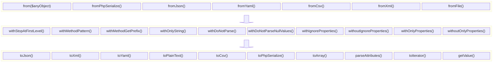

# Serialize class

Using the `Serialize` class, you can convert any object into an array or other formats.

During the process, you can apply modifiers to customize the serialization.

Here is how `Serialize` works:



## Examples

### Converting any object/content into an array

Just use the `Serialize` class with any kind of object, `stdClass`, or array:

#### Basic Conversion

```php
<?php
$result = \ByJG\Serializer\Serialize::from($data)->toArray();
$result2 = \ByJG\Serializer\Serialize::fromPhpSerialize($anyPhpSerializedString)->toArray();
$result3 = \ByJG\Serializer\Serialize::fromJson($anyJsonString)->toArray();
$result4 = \ByJG\Serializer\Serialize::fromYaml($anyYamlString)->toArray();
$result5 = \ByJG\Serializer\Serialize::fromCsv($anyCsvString)->toArray();
$result6 = \ByJG\Serializer\Serialize::fromXml($anyXmlString)->toArray();
```

In the examples above, `$result` to `$result6` will be associative arrays.

`from()` takes an array or an object, and `fromJson()` and `fromYaml()` hold the same: content that is a
scalar (`"text"`, `42`) throws `TypeError` right away, since none of the `to*()` methods could convert it.
Invalid content throws too: `JsonException` for JSON, Symfony's `ParseException` for YAML.

#### XML Conversion

`fromXml()` accepts an XML string, a `SimpleXMLElement` or a DOM node, and reads it with
the same conventions `toXml()` writes, so `toXml()` then `fromXml()` returns the same
array:

```php
<?php
$xml = '<root version="2"><user id="5">John</user><tags><item>a</item><item>b</item></tags></root>';

\ByJG\Serializer\Serialize::fromXml($xml)->toArray();
// [
//     '@attributes' => ['version' => '2'],
//     'user' => ['@attributes' => ['id' => '5'], '@value' => 'John'],
//     'tags' => ['a', 'b'],
// ]
```

- The root element is not part of the array.
- `@attributes` holds an element's attributes; `@value` holds its text when it also has
  attributes or children.
- Elements named like the list element (`item` by default) are list entries, even when
  there is only one. Pass `listElement: 'user'` (and `listElementSuffix: true` for
  `user0`, `user1`, ...) to match how the XML was written, or `listElement: null` to read
  only repeated siblings as a list.
- Every value is a string: XML has no types.
- An element or attribute in a namespace keeps its prefix (`x:isbn`, `xsi:type`, `xml:lang`),
  and a namespace declaration is an attribute, as in XML: `xmlns:x`, or `xmlns` for a default
  namespace. A DOM node of a bigger document also gets the declarations of its parents, so
  the array is complete on its own. `toXml()` writes the namespaces back:

  ```php
  <?php
  $serialize = \ByJG\Serializer\Serialize::fromXml('<book xmlns:x="urn:x"><title>T</title><x:isbn>111</x:isbn></book>');
  $serialize->toArray();   // ['@attributes' => ['xmlns:x' => 'urn:x'], 'title' => 'T', 'x:isbn' => '111']
  $serialize->toXml();     // <root xmlns:x="urn:x"><title>T</title><x:isbn>111</x:isbn></root>
  ```
- CDATA is read as text. Entities are never expanded and nothing is fetched from the
  network, so an external entity (XXE) is not resolved.
- Invalid XML throws `ByJG\Serializer\Exception\InvalidArgumentException`.

#### CSV Conversion with Headers

When working with CSV data, you can specify whether the CSV has a header row:

```php
<?php
// With headers (default)
$result = \ByJG\Serializer\Serialize::fromCsv($csvWithHeaders)->toArray();

// Without headers
$result = \ByJG\Serializer\Serialize::fromCsv($csvWithoutHeaders, false)->toArray();
```

When `hasHeader` is set to `true` (default), the first row of the CSV is treated as column names, and each subsequent row is converted to an associative array using these column names as keys. When `hasHeader` is set to `false`, each row is treated as a simple indexed array.

The content is read as RFC 4180 records: a quoted value may contain commas, doubled quotes (`""`) and
line breaks, and the lines may end in LF or CRLF. Empty lines are skipped. With a header row, every record
must have as many fields as the header; otherwise `ByJG\Serializer\Exception\InvalidArgumentException` is thrown.

An unclosed quote is not detected: PHP's CSV parser (`fgetcsv()`) reads it to the end of the content without an
error, so the rest of the content becomes part of that value (`John,"unclosed\nJane,x` gives `John` and
`unclosed\nJane,x`). A quote inside an unquoted value (`5" screen`) is kept as it is.

#### Reading a file block by block: `fromFile()` and `toIterator()`

`fromFile()` reads a file by its extension: `.csv`, `.xml`, `.json`, `.yaml` or `.yml`.

A CSV or XML file is not loaded into memory. It is read one block at a time, and again each
time it is used. `toIterator()` returns the blocks one by one, each a `Serialize` with the same
options, so a file with millions of records keeps the memory flat:

```php
<?php
use ByJG\Serializer\Serialize;

$serialize = Serialize::fromFile('/data/people.csv')->withOnlyProperties(['name', 'email']);

foreach ($serialize->toIterator() as $index => $block) {
    $block->toArray();   // ['name' => 'John', 'email' => 'john@example.com']
    $block->toJson();    // {"name":"John","email":"john@example.com"}
}
```

The other methods (`toArray()`, `toJson()`, `toXml()`, `toYaml()`, `toCsv()`...) work over all
the blocks and return them as a list. They build the whole result, so on a big file loop with
`toIterator()` instead.

What a block is:

| File | Block |
|------|-------|
| CSV | A record, keyed by the header row, read as `fromCsv()` reads it |
| XML | Each child of the root element, or with `blockElement` the elements with that name at any depth |
| JSON, YAML | Each item of a top-level list; anything else is a single block |

```php
<?php
// <export><header>...</header><data><row>...</row><row>...</row></data></export>
Serialize::fromFile('/data/export.xml', blockElement: 'row')->toArray();
```

An element with the block's name inside a block is part of that block, not a new one.

A block keeps the value it was read as, and converts it only when a `to*()` method is called:

| Block | `getValue()` |
|-------|--------------|
| XML | The original element, a `DOMElement` (for XPath, `saveXML()`...) |
| CSV | The record, keyed by the header row |
| JSON, YAML | The item |

`getValue()` of the `Serialize` of a CSV or XML file returns the values of all the blocks, all in
memory; of any other `Serialize`, the model given to `from*()`.

An XML block converted by `toArray()`, `toJson()`, `toYaml()`... is read as `fromXml()` reads a
document: its own name is dropped, its attributes are under `@attributes`, and `item` elements are
list entries.

`toXml()` of an XML block writes its original element, without a conversion: the conversion to an
array loses the order of the siblings, namespaced elements and text mixed with elements. For the
whole file, the blocks are inside a `root` element:

```php
<?php
// <bookstore><book category="WEB"><title>Learning XML</title><author>A</author><author>B</author></book>...</bookstore>
foreach (Serialize::fromFile('/data/books.xml', blockElement: 'book')->toIterator() as $block) {
    $block->getValue();   // DOMElement <book>
    $block->toXml();      // <?xml version="1.0"?>\n<book category="WEB">...</book>, as it is in the file
    $block->toJson();     // {"@attributes":{"category":"WEB"},"title":"Learning XML","author":["A","B"]}
}
```

With an option (`withOnlyProperties()`, `withIgnoreProperties()`...) or a `toXml()` parameter, the
element is converted to an array first, so they apply.

Notes:

- PHP has no streaming parser for JSON or YAML: `fromFile()` reads the whole file, as `fromJson()`
  and `fromYaml()` do, and throws on invalid content.
- A missing file, an unknown extension, or `blockElement` for a file that is not XML throws
  `ByJG\Serializer\Exception\InvalidArgumentException` when `fromFile()` is called.
- An invalid CSV record or invalid XML throws the same exception when the reading reaches it, so
  the blocks before it may already have been processed. libxml reads ahead, so for XML that can
  happen before the blocks that come just before the error.
- `toIterator()` works on any `Serialize`: the blocks are the items of a list of arrays or objects,
  and any other value is a single block.
- `fromFile()` creates a `ByJG\Serializer\Reader\CsvReader` or `XmlBlockReader`. Both implement
  `ByJG\Serializer\Reader\FileBlocks`, and `from()` reads any `FileBlocks` the same way:
  `Serialize::from(new XmlBlockReader('/data/books.xml', 'book'))` is
  `Serialize::fromFile('/data/books.xml', blockElement: 'book')`. Another object that can be iterated
  (a collection) is not `FileBlocks`, so `from()` converts it as any object.

### Formatting an array into JSON, YAML, XML, CSV, or Plain Text

You can format data using formatter classes directly or through the `Serialize` class:

```php
<?php
$data = [ ... any array content or model object ... ]

echo Serialize::from($data)->toJson();
echo Serialize::from($data)->toXml();
echo Serialize::from($data)->toXml(rootElement: 'users', listElement: 'user');
echo Serialize::from($data)->toYaml();
echo Serialize::from($data)->toCsv();
echo Serialize::from($data)->toPlainText();
echo Serialize::from($data)->toPhpSerialize();
$array = Serialize::from($data)->parseAttributes($callback, $attributeClass);
```

For detailed formatter documentation including customization options, configuration methods, and examples, see the **[Formatters Guide](formatters.md)**.

### Cross-format conversion

You can chain any input method with any output method to convert between formats directly:

```php
<?php
use ByJG\Serializer\Serialize;

// From PHP's native serialize() to array
$serialized = serialize(['a' => 1, 'b' => 2]);
$array = Serialize::fromPhpSerialize($serialized)->toArray();
// [ 'a' => 1, 'b' => 2 ]

// From JSON to YAML
$json = '{"foo": "bar"}';
$yaml = Serialize::fromJson($json)->toYaml();

// From YAML to JSON
$yaml = "foo: bar\nanswer: 42\n";
$json = Serialize::fromYaml($yaml)->toJson();
```

### Customizing the Serialization

These are the possible modifiers for parsing:

| Method                   | Description                                                             |
|--------------------------|-------------------------------------------------------------------------|
| withDoNotParseNullValues | Ignore null elements                                                    |
| withDoNotParse           | Ignore some classes and return them as is                               |
| withOnlyString           | Return only string elements                                             |
| withMethodPattern        | Use the pattern to convert method into property                         |
| withMethodGetPrefix      | Set the prefix for getter methods (default is 'get')                    |
| withStopAtFirstLevel     | Only parse the first level of nested objects                            |
| withIgnoreProperties     | Specify properties to exclude at every level (denylist)                 |
| withoutIgnoreProperties  | Clear the denylist                                                      |
| withOnlyProperties       | Specify the only properties of the model to include (allowlist)         |
| withoutOnlyProperties    | Clear the allowlist                                                     |

#### Ignore null elements: `withDoNotParseNullValues()`

By default, the `Serialize` class includes all properties. For example:

```php
<?php
$myclass->setName('Joao');
$myclass->setAge(null);

$result = \ByJG\Serializer\Serialize::from($myclass)->toArray();
print_r($result);

// Will return:
// Array
// (
//     [name] => Joao
//     [age] => 
// )
```

To ignore null elements:

```php
<?php
$result = \ByJG\Serializer\Serialize::from($myclass)
            ->withDoNotParseNullValues()
            ->toArray();
print_r($result);

// And the result will be:
// Array
// (
//     [name] => Joao
// )

```

#### Do not parse specific classes: `withDoNotParse([object])`

To serialize an object but ignore specific class types:

```php
<?php
$result = \ByJG\Serializer\Serialize::from($myclass)
            ->withDoNotParse([
                MyClass::class
            ])
            ->toArray();
```

#### Backed enums are written as their value

A backed enum is serialized to its `->value`, the same as `json_encode()` writes it, at every
level (also with `withStopAtFirstLevel()`). A pure enum has no value and is serialized like any
other object.

```php
<?php
enum Status: string
{
    case Paid = 'PAID';
}

class Payment
{
    public ?Status $status = Status::Paid;
}

$result = \ByJG\Serializer\Serialize::from(new Payment())->toArray();
// ['status' => 'PAID']
```

#### Return only string elements: `withOnlyString()`

To serialize an object and return only string elements:

```php
<?php
$model = new stdClass();
$model->varFalse = false;
$model->varTrue = true;
$model->varZero = 0;
$model->varZeroStr = '0';
$model->varNull = null;
$model->varEmptyString = '';

$result = \ByJG\Serializer\Serialize::from($model)
            ->withOnlyString()
            ->toArray();

// It will return:
// Array
// (
//     [varFalse] => ''
//     [varTrue] => '1'
//     [varZero] => '0'
//     [varZeroStr] => '0'
//     [varNull] => ''
//     [varEmptyString] => ''
// )
``` 

#### Use the pattern to convert method into properties: `withMethodPattern($pattern, $replace)`

In the class we might have the name `property` name different from the getter method.

The default configuration is to remove everything in the `property`
that doesn't match with the `$pattern = '/([^A-Za-z0-9])/'`

If you need something different you can use the `withMethodPattern` to define your own pattern.
The pattern must be at least 2 characters long and enclosed in matching delimiters (e.g. `/[_]/`);
otherwise an `InvalidArgumentException` is thrown.

#### Set the prefix for getter methods: `withMethodGetPrefix($prefix)`

By default, the `Serialize` class uses 'get' as the prefix for getter methods. You can change this using the `withMethodGetPrefix` method:

```php
<?php
$result = \ByJG\Serializer\Serialize::from($myclass)
            ->withMethodGetPrefix('fetch')
            ->toArray();
```

#### Only parse the first level of nested objects: `withStopAtFirstLevel()`

To only parse the first level of nested objects:

```php
<?php
$result = \ByJG\Serializer\Serialize::from($myclass)
            ->withStopAtFirstLevel()
            ->toArray();
```

#### Ignore specific properties: `withIgnoreProperties([$prop1, $prop2])`

To ignore specific properties during serialization. A property is ignored at every level, also in
the nested objects and arrays, so a `password` is hidden wherever it is:

```php
<?php
$result = \ByJG\Serializer\Serialize::from($myclass)
            ->withIgnoreProperties(['password', 'secretKey'])
            ->toArray();
```

#### Clear the list of ignored properties: `withoutIgnoreProperties()`

To clear the list of properties to ignore:

```php
<?php
$result = \ByJG\Serializer\Serialize::from($myclass)
            ->withIgnoreProperties(['password'])
            ->withoutIgnoreProperties() // Clear the ignore list
            ->toArray();
```

#### Keep only some properties: `withOnlyProperties([$prop1, $prop2])`

To keep only some properties of the model. A property kept is kept whole: the properties of its value
are not filtered. For a list of arrays or objects, the properties are the ones of each item, as each
block of `toIterator()`:

```php
<?php
$data = ['name' => 'John', 'age' => 30, 'address' => ['street' => 'Main St', 'city' => 'Rio']];

\ByJG\Serializer\Serialize::from($data)
    ->withOnlyProperties(['name', 'address'])
    ->toArray();
// ['name' => 'John', 'address' => ['street' => 'Main St', 'city' => 'Rio']]

\ByJG\Serializer\Serialize::from([['name' => 'John', 'age' => 30], ['name' => 'Jane', 'age' => 25]])
    ->withOnlyProperties(['name'])
    ->toArray();
// [['name' => 'John'], ['name' => 'Jane']]
```

`withoutOnlyProperties()` clears the list.

#### parseAttributes

The `parseAttributes` method allows you to process object properties with custom logic, optionally filtering by PHP 8 attributes. It's similar to `toArray()` but provides a per-property callback for transformation.

```php
public function parseAttributes(?Closure $attributeFunction, ?string $attributeClass = null): array
```

**Basic Example:**

```php
#[Attribute]
final class Label {
    public function __construct(public string $text) {}
}

final class Product {
    #[Label('SKU')]
    public string $id = 'A-123';

    #[Label('Pretty name')]
    public string $name = 'Fuzzy Panda';
}

$prod = new Product();

$result = Serialize::from($prod)->parseAttributes(
    // Callback receives ($attributeInstance, $value, $keyName, $propertyName, $getterName)
    function ($attr, $value, $key, $prop, $getter) {
        // If the attribute exists, append its label
        return $attr ? "{$value} ({$attr->text})" : $value;
    },
    Label::class // Only parse this attribute type
);
// Result: ['id' => 'A-123 (SKU)', 'name' => 'Fuzzy Panda (Pretty name)']
```

The callback receives five parameters: `$attribute` (attribute instance or null), `$value` (parsed property value), `$keyName` (reflected property name), `$propertyName` (output key name), and `$getterName` (getter method name or null). When `$attribute` is `null`, the property has no matching attribute — check before accessing attribute members.

This method is particularly useful when working with PHP 8 attributes to customize serialization based on metadata annotations.

## Advanced Features

### PHP Serialization with toPhpSerialize()

The `toPhpSerialize()` method provides two modes:

```php
// Direct mode - serializes object as-is, preserving class type
$serialized = Serialize::from($model)->toPhpSerialize();

// Parse mode - converts to array first, then serializes (applies modifiers)
$serialized = Serialize::from($model)->toPhpSerialize(true);
```

Use direct mode to preserve object structure for deserialization. Use parse mode to apply transformations (like `withIgnoreProperties()`) before serializing.

### Anonymous Class Support

The Serialize class automatically handles anonymous classes, detecting them and including both getter methods and public properties. Getter methods take precedence over public properties when both exist. The options and `parseAttributes()` apply to them as to any class.

### Performance and Caching

The Serialize class implements internal caching to improve performance when serializing multiple objects of the same type:

**What is cached:**
- Property metadata (getters, key names, attributes)
- ReflectionClass instances
- Method existence checks

**Benefits:**
- Significant performance improvement for bulk serialization
- Reduced reflection overhead
- Automatic cache management (no configuration needed)

**Example:**
```php
// First serialization: cache is built
$users = [];
for ($i = 0; $i < 1000; $i++) {
    $users[] = Serialize::from($user)->toArray();
}
// Subsequent serializations use cached metadata
```

**Note:** The cache is stored statically and persists for the lifetime of the PHP process. In long-running applications (e.g., CLI workers), this provides continuous performance benefits.

## Related Components

The PHP Serializer library includes several other components to help with object manipulation:

- **ObjectCopy**: [See dedicated documentation](objectcopy.md)
- **ObjectCopyTrait**: [See dedicated documentation](objectcopytrait.md)
- **BaseModel**: [See dedicated documentation](basemodel.md)
- **DirectTransform**: [See dedicated documentation](directtransform.md)
